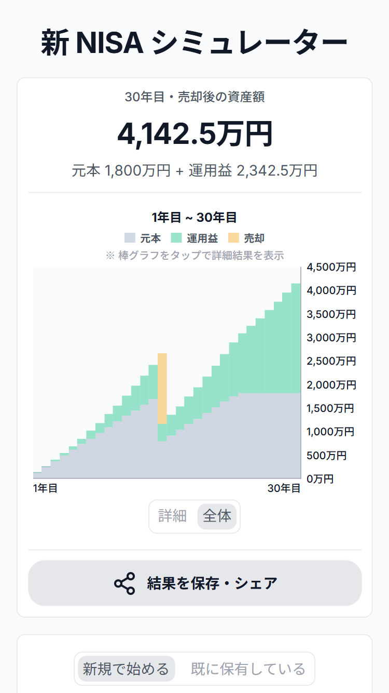

# 新 NISA シミュレーター

新NISAの積立運用および**売却に伴う非課税保有限度額（簿価残高）の翌年復活**を月次ベースで計算するWebシミュレーターです。

- **Demo:** [https://andreicasimina.github.io/new-nisa-simulator/](https://andreicasimina.github.io/new-nisa-simulator/)
- **Design (Figma):** [New NISA Simulator - Design](https://www.figma.com/design/ZEBPLk11SdBrFcdhFwg78e/New-NISA-Simulator---Design?node-id=18-103&m=dev)



## 概要

新NISAでは、保有資産を売却するとその**簿価分の非課税枠が翌年1月1日に復活**します。本ツールはこの制度仕様を月次台帳モデルとして実装し、積立・取り崩し・枠の再利用を含めた長期の資産推移と非課税メリット（譲渡益税率 20.315% 換算）を算出します。

## 主な機能

- **制度上限の自動制御:** 年間投資枠（つみたて 120万円 / 成長 240万円、合計 360万円）および生涯非課税保有限度額（1,800万円、うち成長投資枠 1,200万円）の上限判定と超過分の繰り越し・制限処理
- **取り崩し（マイルストーン売却）と枠復活:** 任意の経過年における売却額・対象枠（つみたて / 成長 / 按分）を複数設定可能。売却簿価に基づく枠の復活時期および元本回復年を算出
- **既存保有資産からのシミュレーション:** 現在の元本（簿価）と評価額を枠別に入力し、途中経過からの試算に対応
- **年次・月次内訳とグラフ表示:** 資産推移の棒グラフ表示および、ボトムシートでの年次・月次詳細データの確認
- **URLによる状態共有:** 入力パラメータを `lz-string` で圧縮してクエリ文字列にエンコードし、復元時に `zod` スキーマでバリデーションを実施

## 設計・アーキテクチャ

UI/UX設計は Figma でプロトタイピングを行い、フロントエンドは計算ロジック（`core/`）とプレゼンテーション層（`ui/`）を分離して構成しています。

```text
src/
├── core/          # UI非依存のドメインロジック
│   ├── engine/    # 月次シミュレーションエンジン・制度定数・ユニットテスト
│   ├── store/     # Zustand による状態管理
│   ├── types/     # 制度・アプリケーション状態の型定義
│   └── url/       # URLパラメータの圧縮・復元・Zodバリデーション
└── ui/            # React コンポーネント・カスタムフック・表示用フォーマッタ
```

## 技術スタック

| カテゴリ | 技術 |
| --- | --- |
| Framework | React 19, TypeScript |
| Build Tool | Vite 6 |
| Styling | Tailwind CSS 4 |
| State Management | Zustand |
| Validation / URL | Zod, lz-string |
| Testing | Vitest |
| Hosting / CI | GitHub Pages, GitHub Actions |

## ローカル開発

```bash
npm install
npm run dev      # 開発サーバー起動 (http://localhost:3000)
npm test         # Vitest によるユニットテスト実行
npm run build    # 型チェックおよび本番ビルド
```

## 免責事項

本シミュレーターの試算結果は一定の仮定に基づく概算値であり、将来の運用成果を保証するものではありません。実際の投資判断はご自身の責任で行ってください。

## ライセンス

[MIT License](LICENSE)